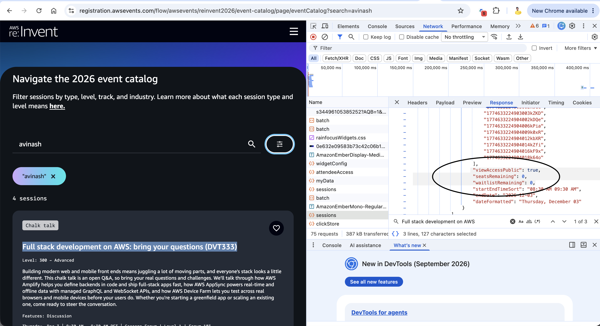
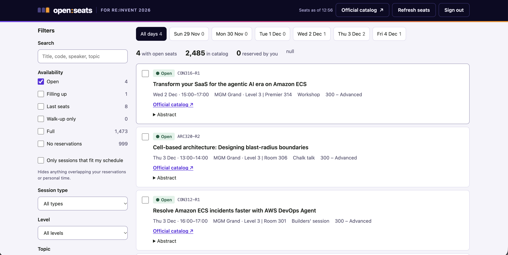
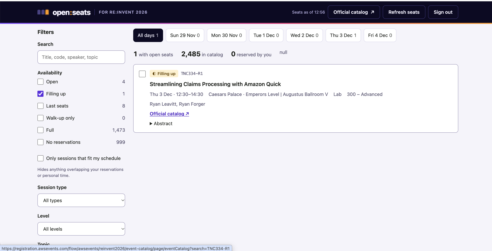
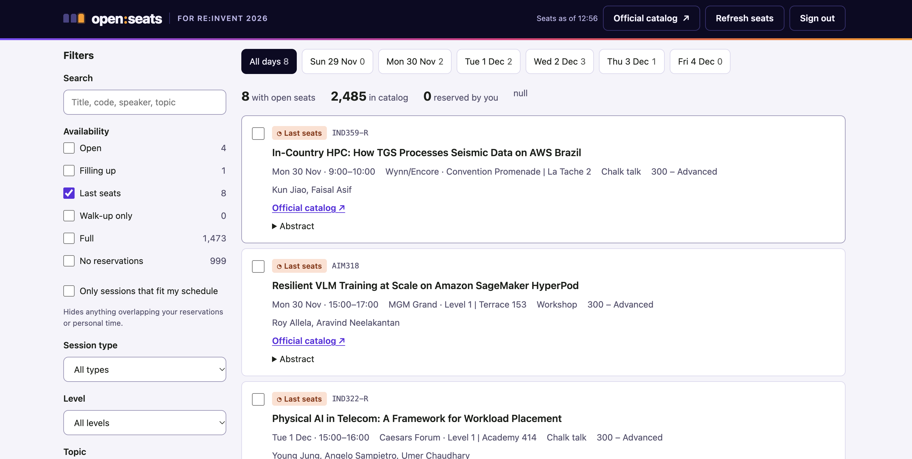

# Diwali, Butter Chicken and a Full re:Invent Catalog: How I Built Open Seats to Find Sessions I Can Still Attend

AWS re:Invent is almost 1 month from now. I was looking to reserve my seat for some specific talks and chalk talks. I tried multiple times, but I could not find anything. And I kept postponing things. By the time I sat down properly, I already lost almost 6-7 sessions which I really wanted to attend.

## The Problem That Started It All

Now the event is getting closer, so I need to start planning my schedule. People are reaching out, sending meeting invites and everything. So I need to know first: what are the sessions I am going to attend?

I checked the event catalog. Most of the talks were at full capacity. And I did not find any good option for filtering. There is no filter for "has seats left". I wanted to filter out which sessions are available, which I can target, and which also match my interest: AWS, serverless, agentic AI and architecture.

I didn't want to open every session one by one and check. Later I found the catalog has 2,485 sessions. Nobody can check that by hand.

So I started thinking, why not build something? If it solves my problem, it can help other people also.

## First Thing I Did: Inspect Element

So, I did inspect element on the catalog page and checked the APIs behind it. There is a `sessions` API, and in the response I found some parameters which actually helped me:

```json
"viewAccessPublic": true,
"seatsRemaining": 0,
"waitlistRemaining": 0,
```

This is what I saw in Chrome DevTools, in the Network tab, for the `sessions` call. Here it is for the chalk talk *Full stack development on AWS: bring your questions* (DVT333). Both `seatsRemaining` and `waitlistRemaining` are `0`, so no seat and no waitlist also.



So the data is already there. I can know which sessions have seats, which have only waitlist, and which are completely full. I found, okay, why not build a small tool with this?

## Diwali, Butter Chicken and a Hackathon Mail

Today is Diwali. Already cooking is happening at home, and I am making butter chicken today. In between, I got a mail about the re:Invent event catalog API hackathon, and today is the deadline.

So it is a kind of good combination. The tool will solve my problem, and I can participate in the hackathon with it also. So I was doing both things together, cooking butter chicken and building this tool.

But there was one problem with the inspect element approach. The request I copied as curl from the browser had my session cookies and auth token inside it. Those tokens expire, and anyone who gets that curl can act as me on the registration site. Also this is an internal API of the website, not something built for us developers.

## Then I Found the Official Events API

While reading the hackathon page, I found that for the first time AWS opened programmatic access to the re:Invent 2026 session catalog. It comes with two front doors: a REST API (OpenAPI 3.1) and a remote MCP server for AI agents. Every operation is available on both.

What I can do with it:

- List the full session catalog
- Get my schedule (reservations, favorites, personal time)
- Favorite sessions
- Block personal time
- Reserve and cancel seats

So instead of the internal API, I decided to build on the official one. Same problem solved, and it is my hackathon entry also.

One thing I didn't realise first. In the official API, there is no exact `seatsRemaining` count. Each session has `isReservable` and a `seatAvailability` field, and it is a band:

```
available | limited | veryLimited | unavailable | walkUp
```

First I thought this is not enough, because I wanted the number. But for my use case it is fine. I only need to know "can I get in or not". A band is enough for that.

## What I Built: Open Seats

Open Seats is a small local web app. You run one Python file, sign in with your AWS Builder ID, and it does this:

1. Pulls the full re:Invent 2026 catalog using `ListSessions`.
2. Shows only sessions with open seats by default (*Open*, *Filling up*, *Last seats*). Full and walk-up sessions are one checkbox away. Each one shows a count.
3. Reads my schedule using `GetSchedule` and can hide sessions which clash with my reservations or personal time.
4. Filters by day, session type, level, topic and free text search. So I can search "serverless" or "agentic" and only see open sessions for my interests.
5. I select up to 10 sessions and reserve them in one click (`ReserveSessions`), or add them to favorites (`AssociateFavorites`).
6. Every session has a link to the official re:Invent catalog, so I can check full details there.

This is how it looks with only *Open* sessions:



## The Numbers Were Worse Than I Thought

When I first loaded the full catalog, I checked the counts. As of 12:56 PM IST on 7 November:

| Availability | Sessions |
|---|---|
| Open | 4 |
| Filling up | 1 |
| Last seats | 8 |
| Full | 1,473 |
| No reservations | 999 |
| **Total in catalog** | **2,485** |

So out of 1,486 sessions which take reservations, only 13 have any seat left. That is less than 1%. No wonder every session I opened was full. Losing those 6-7 sessions was not bad luck, I was just late.

But those 13 are real options. For example, *Cell-based architecture: Designing blast-radius boundaries* (ARC320-R2), a chalk talk on Thu 3 Dec, was still *Open*. That is exactly my interest area. Without this tool I would never find it in 2,485 sessions.

The *Filling up* filter showed only one session:



And *Last seats* showed 8, spread from Monday to Thursday:



## How It Works

The architecture is simple:

```
Browser (web UI)  ──►  server.py on localhost:8484  ──►  api.awsevents.com/v1
                            │
                            └── OAuth 2.0 + PKCE ──►  oauth.awsevents.com (AWS Builder ID)
```

I kept it with zero dependencies. Python standard library for the server, plain JavaScript modules for the UI, no build step. So anyone can clone and run:

```bash
git clone https://github.com/AvinashDalvi89/reinvent-open-seat-finder
cd reinvent-open-seat-finder
python3 server.py
```

## Signing In: OAuth With PKCE on Localhost

The API needs a signed-in attendee who is registered for re:Invent 2026. Without token, I did curl to the sessions endpoint and it gave `401`.

The sign-in is OAuth 2.0 authorization code flow with PKCE. There is one public client ID, same for everyone, and no client secret. This took me some time to understand: the redirect URI must be exactly on one of six reserved loopback ports, `8484` to `8489`, with `/callback` path. Any other port fails. That's why the server runs on `8484` by default.

One more thing, if your Builder ID is not registered for re:Invent, sign-in works fine but the API gives `403`. Sign-in again doesn't fix it. You have to register on the event site.

I also didn't want tokens in the browser. So the local server keeps the tokens only in memory and sends API calls on behalf of the browser. When you stop the server, tokens are gone. Sign out also revokes the refresh token.

## The Gotchas I Found in the API Docs

Reading the docs carefully saved me from few bugs.

**A short page is not the last page.** `ListSessions` has no search or filter on the server side, so I have to pull every page and filter in the browser. Pagination is by `nextToken`. I stop only when `nextToken` is missing, not when a page looks small.

**A 200 doesn't mean everything is reserved.** `ReserveSessions` returns `successful` and `failed` lists. Even with 200 response, some sessions can fail with a code like `sessionFull`, `scheduleConflict` or `alreadyScheduled`. For a clash, it also returns `conflictsWith` with the session IDs. So the app shows result per session, like "Clashes with X", instead of just saying "done".

**Don't retry a reservation blindly.** If I send the same request again, the already reserved sessions now fail as `alreadyScheduled`. So the app never auto retries reservations.

**Rate limits are per attendee.** `ListSessions` is 120 per minute. Reserve is 30 sessions per minute, counted per session, not per request. On `429` the API sends `Retry-After`, and the app waits for that.

**Refresh once, then sign in again.** On `401`, refresh the token one time and retry. If it is still `401`, ask the user to sign in again, don't loop.

## What I Learned

- Don't wait to reserve re:Invent sessions. One month before the event, less than 1% of reservable sessions had seats. I lost 6-7 sessions I wanted because of this.
- The data I needed was already there in the catalog. Only the filter was missing.
- A rough availability band is enough for planning. I didn't need exact seat count.
- Copying a curl with my cookies from dev tools works for a quick test, but it is not something to share or commit. The official API with proper sign-in is the right way.
- Small detail like "200 with failures" can make a tool lie to the user if you don't read the docs.

## What's Next

Next I want to add a watch mode, which checks a full session I favorited and tells me when a seat opens up. People cancel, so seats do come back. I also want to try the same logic through the MCP server, so I can ask an agent "fill my Tuesday afternoon with open serverless sessions".

If you are going to re:Invent and also tired of seeing "Full", try it and tell me what filter you want next.

Code: https://github.com/AvinashDalvi89/reinvent-open-seat-finder
